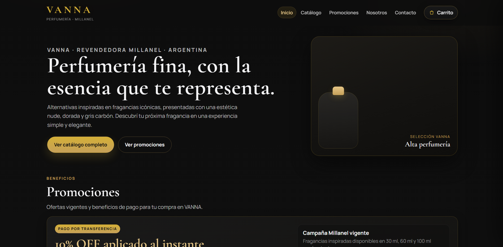
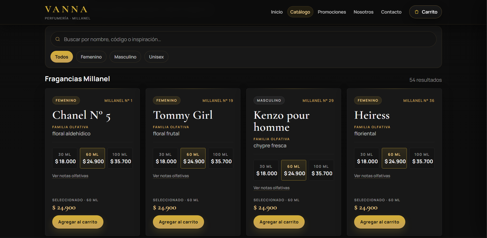
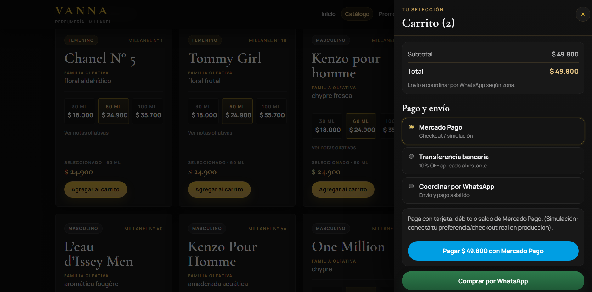
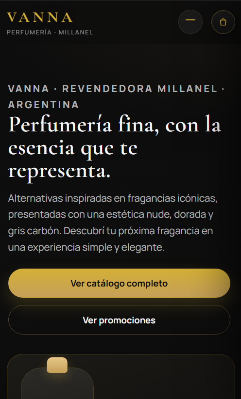

# VANNA Perfumería

Tienda web para **VANNA Perfumería**, revendedora de fragancias **Millanel** en Argentina.  
Aplicación desarrollada con **React + Vite**, con estética de lujo en **negro y dorado**, navegación por vistas, catálogo con buscador/filtros y carrito con opciones de pago.

> Las marcas mencionadas como inspiración olfativa son referencias; Millanel no está afiliada a los titulares originales.

## Capturas

Colocá las imágenes en `public/assets/` y actualizá los nombres si hace falta.

| Vista | Captura |
|---|---|
| Inicio |  |
| Catálogo |  |
| Carrito / checkout |  |
| Mobile |  |

## Características

- **Navegación por vistas** (no scroll infinito como página única):
  - **Inicio**: portada de lujo, promociones, perfumes destacados (máx. 6) y secciones Nosotros/Contacto.
  - **Catálogo**: vista independiente con grilla completa.
- **Navbar** con enlaces a Inicio, Catálogo, Promociones, Nosotros y Contacto + acceso al carrito (contador).
  - Desde Catálogo, Promociones/Nosotros/Contacto llevan a Inicio con desplazamiento suave a la sección correspondiente.
- **Catálogo**:
  - Búsqueda en tiempo real por nombre, código, inspiración, familia o género.
  - Filtros por género: Todos, Femenino, Masculino, Unisex.
  - Tarjetas con inspiración como nombre principal, referencia Millanel, familia olfativa, tamaños **30/60/100 ml**, precios y notas olfativas (cuando están disponibles).
- **Carrito deslizable**:
  - Selección por producto + tamaño, cantidades, subtotal y total.
  - **Mercado Pago**: botón de checkout (simulación; listo para integrar link/Checkout Pro real).
  - **Transferencia bancaria**: **10% de descuento automático** aplicado al total, con alias/CBU/titular visibles.
  - **Comprar por WhatsApp**: genera un enlace `wa.me` con el pedido formateado (ítems, tamaños, cantidades, totales, método y envío a coordinar).
- **Datos**: catálogo cargado desde `src/data/perfumes.js` (fragancias Millanel procesadas desde `catalogo-input/C09-26.pdf`).
- **Diseño**: responsive, minimalista premium, paleta negro/carbón + dorado.

## Stack

- [React](https://react.dev/)
- [Vite](https://vite.dev/)
- JavaScript (ESM)
- CSS (sistema de estilos en `src/App.css` / `src/index.css`)

## Requisitos

- Node.js (recomendado: versión LTS reciente)
- npm

## Instalación y uso

```bash
npm install
npm run dev
```

Abrí la URL que indique Vite (normalmente `http://localhost:5173`).

### Scripts

```bash
npm run dev      # entorno de desarrollo
npm run build    # build de producción
npm run preview  # previsualizar build
npm run lint     # ESLint
```

## Configuración

Antes de publicar, reemplazá los placeholders:

### WhatsApp y contacto
- `src/components/CartDrawer.jsx`
  - `WHATSAPP_NUMBER` (formato: país + área + número, sin `+`, ej. `54911XXXXXXXX`)
- `src/components/AboutContact.jsx`
  - `WHATSAPP_NUMBER`

### Transferencia bancaria (10% OFF)
- `src/components/CartDrawer.jsx`
  - `TRANSFER_ALIAS`
  - `TRANSFER_CBU`
  - `TRANSFER_TITULAR`

### Mercado Pago
- `src/components/CartDrawer.jsx`: la integración actual es una **simulación**. Conectá tu link de pago, Checkout Pro o SDK según tu implementación.

### Precios y catálogo
- `src/data/perfumes.js`: precios por tamaño (`tamanos[].precio`), stock, destacados y datos de fragancias.
- Los precios se calculan en el frontend a partir de este archivo (el carrito y las tarjetas se actualizan automáticamente).

## Estructura del proyecto

```text
.
├─ public/
│  └─ assets/                 # capturas para el README
├─ src/
│  ├─ components/
│  │  ├─ Navbar.jsx           # navegación por vistas + carrito
│  │  ├─ Home.jsx             # inicio: hero, promos, destacados, nosotros, contacto
│  │  ├─ CatalogSection.jsx   # catálogo completo: búsqueda y filtros
│  │  ├─ ProductGrid.jsx      # grilla de resultados
│  │  ├─ ProductCard.jsx      # tarjeta, tamaños, notas, agregar al carrito
│  │  ├─ Promotions.jsx       # sección promociones
│  │  ├─ AboutContact.jsx     # secciones nosotros y contacto
│  │  └─ CartDrawer.jsx       # carrito, totales, pago y WhatsApp
│  ├─ data/
│  │  └─ perfumes.js          # catálogo de fragancias
│  ├─ App.jsx                 # estado global (vista, carrito) y composición
│  ├─ App.css                 # estilos principales / tema
│  ├─ index.css               # base global
│  └─ main.jsx                # entrada React
├─ catalogo-input/            # fuente de catálogo (PDF) y artefactos de extracción
├─ index.html
├─ package.json
└─ vite.config.js
```

## Notas sobre el catálogo

- `src/data/perfumes.js` fue generado a partir del PDF de campaña Millanel ubicado en `catalogo-input/`.
- Algunas fragancias pueden no tener pirámide olfativa completa si la fuente no expone ese dato en texto estructurado; en esos casos la UI muestra “a confirmar/consultar”.
- Revisá códigos, equivalencias, precios y disponibilidad antes de usar en producción.

## Licencia

Uso interno/comercial según corresponda al proyecto VANNA.  
Logos y nombres de marcas de terceros pertenecen a sus respectivos titulares.
